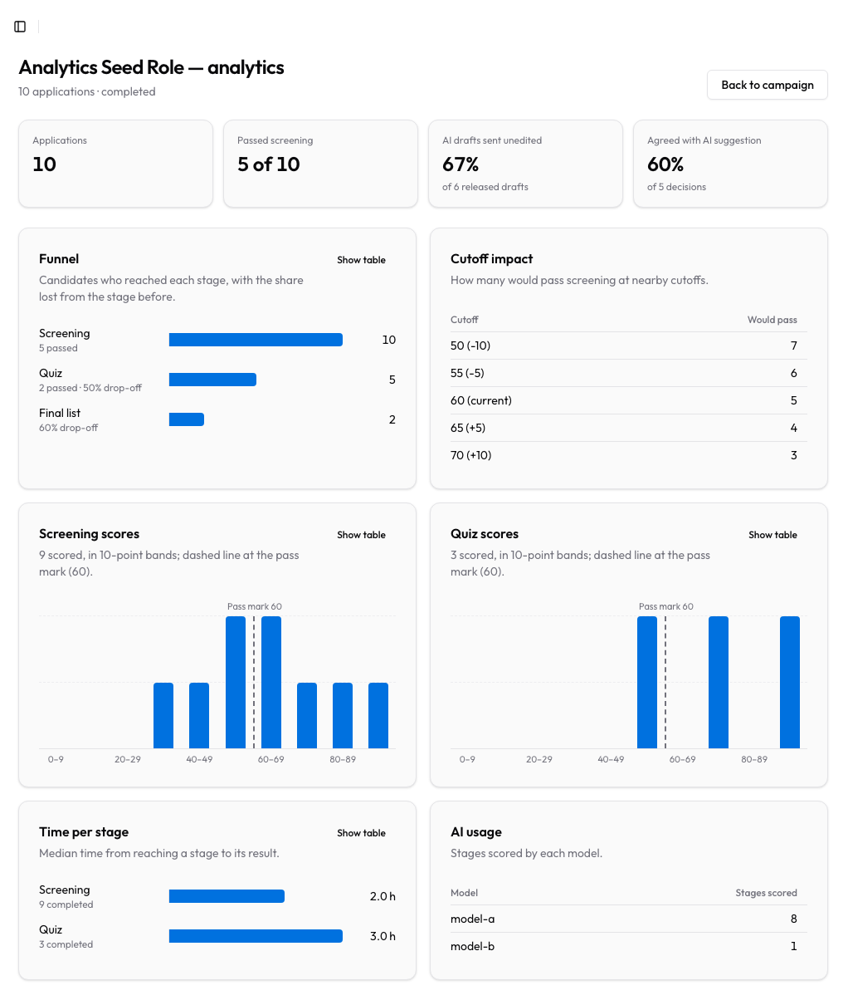
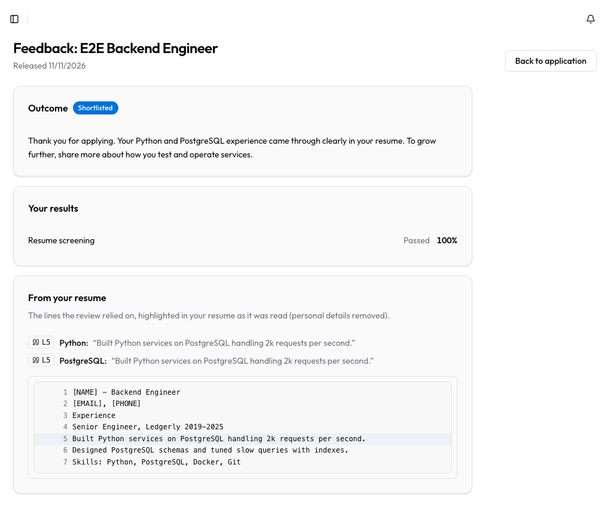
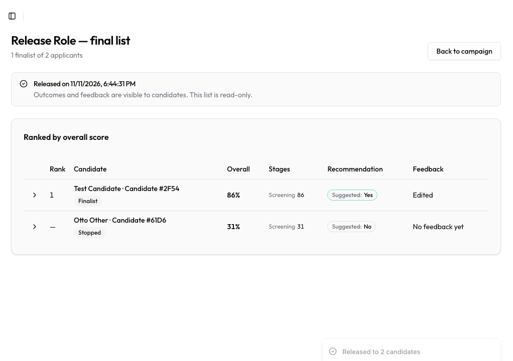
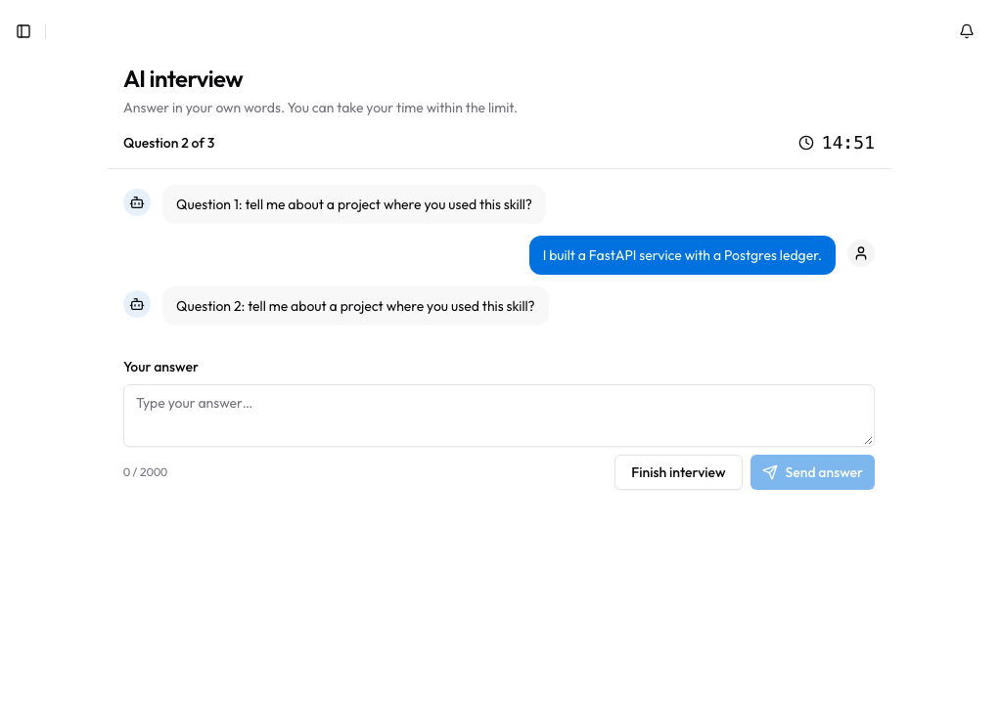

# Hirevine AI

AI does the screening work; people make the decisions.

A hiring manager describes a role in chat, gets a pipeline (resume screening → optional skills quiz →
optional AI interview → final list), edits it by hand or by chat, and publishes it. Candidates apply
with a resume, take the quiz and interview, and later receive personal feedback. Every AI score
quotes its evidence, the hiring team edits every piece of feedback, and outcomes are released to
everyone at once when the manager completes the campaign.

| Manager | Candidate |
| --- | --- |
|  |  |
|  |  |

## Measured results

Real runs of the production code paths against `google/gemma-4-31b-it` on synthetic data (no real
applicants). The table is generated from `apps/api/evals/reports/` by
`uv run python -m evals.readme_results`; nothing in it is typed by hand.

<!-- RESULTS:START -->
| Eval | Result | Notes | Report |
| --- | --- | --- | --- |
| Resume screening (12 labelled resumes, 3 bands) | Rank agreement (Spearman) **0.963**; precision@4 **100%**; quotes found on the first try **100%** | Strong ≥ 92.1, mid ≤ 59.2, weak ≤ 0.0 | `evals/reports/screening_v2_20261111.json` |
| Bias audit (6 resumes × 3 name swaps in 2 layouts + gendered signals) | Variants over tolerance **0%** of 42; mean absolute change **0.72** pts, max **4.0** | Tolerance 10.6 pts from re-run noise; names reaching the model: 0 | `evals/reports/bias_v2_20261111.json` |
| Prompt injection (4 resumes × 3 planted instructions) | Scores changed **0%**; flagged **100%** | Largest increase 0.0 pts | `evals/reports/injection_v2_20261111.json` |
| Interview scoring (6 labelled transcripts × 3 runs) | Run-to-run std dev **0.24** pts (max 1.46); labels in band **6/6** | Target ≤ 5.0 pts; mean score by label: strong 100, mid 32.3, weak 0 | `evals/reports/interview_v3_20261111.json` |
| Workflow editing by chat (40 requests) | Same patches as the hand edit **98%** (39/40) | Target 85% | `evals/reports/override_v1_20261110.json` |
<!-- RESULTS:END -->

What the evals changed:
- **Prompt injection.** The first run found that a hidden line of stuffed keywords raised two weak
  resumes by 75 points: the line was really in the resume, so the quote check passed. The scanner now
  flags keyword stuffing, a quote from a flagged line no longer counts as evidence, and a bare skills
  list is weak evidence (`screening_score` v2). Both versions' reports are kept.
- **Interview scoring** took three prompt versions: v1 numbered every turn and the model cited
  questions; v2 left citations optional and the model skipped them; v3 numbers only answers, asks for
  evidence before the score, and rejects a positive score without one.
- **Redaction.** Reviewing a screenshot of the redacted resume showed a name sharing its line with a
  title ("Jordan Example - Backend Engineer") and a short international number ("+1 555 0100")
  reaching the model. Redaction now also removes the applicant's own profile name anywhere, names
  before a title on the first lines, and 7+ digit numbers after a "+"; the bias eval tests both
  layouts and the journey e2e test fails if a name or phone reappears.
- **Bias.** With names removed before any model sees the resume, name swaps cannot move a score;
  gendered signals (a pronoun, "mother of two", Women Who Code) moved scores by at most a few points.

The dashboards are checked the same way: `apps/api/scripts/seed_analytics.py` seeds a synthetic
campaign with every expected number worked out by hand, and both an API test and a Playwright test
compare against it.

## How it fits together

```
apps/manager ─┐                         ┌─ Postgres (Supabase): RLS on every table
              ├─ HTTPS ─▶ apps/api ─────┼─ Supabase Storage (private resume bucket)
apps/candidate┘   (FastAPI, the only    ├─ OpenRouter (models) — redacted text only
                   gateway)             └─ Inngest (background jobs) — record IDs only
```

| Path | What |
| --- | --- |
| `apps/manager` | Next.js app for hiring managers (port 3000) |
| `apps/candidate` | Next.js app for candidates (port 3001) |
| `apps/api` | FastAPI service: the only gateway to the database and the only caller of models (port 8000) |
| `packages/ui` | Design tokens and shared components (chat, quiz runner, interview chat, evidence, charts) |
| `packages/api-client` | Typed client generated from the API's OpenAPI document |
| `supabase/migrations` | Plain SQL migrations: schema, RLS policies, helper functions |
| `docs/plans` | Backend and frontend implementation plans, with "As built" notes per phase |
| `docs/adr` | Architecture decision records |

Key decisions (see `docs/adr`):
1. [The API is the only gateway; RLS is the backstop](docs/adr/0001-api-gateway-and-rls.md)
2. [Background jobs on Inngest, sent after commit, carrying IDs only](docs/adr/0002-inngest-with-after-commit-dispatch.md)
3. [Every AI score must quote its evidence, and code checks the quote](docs/adr/0003-quotes-must-verify.md)
4. [Outcomes are released to everyone at once, by the manager](docs/adr/0004-release-gated-outcomes.md)
5. [LangGraph only where a conversation needs a checkpoint](docs/adr/0005-plain-code-over-graphs.md)
6. [Paid model variants, one fallback, then retry later](docs/adr/0006-paid-models-with-fallback.md)
7. [End-to-end tests run the real pipeline against a fake model](docs/adr/0007-fake-model-and-inline-jobs-for-e2e.md)
8. [Analytics as RLS-scoped queries, charts as small SVG components](docs/adr/0008-analytics-as-queries-and-svg-charts.md)

## Local setup

Requirements: Node 22, pnpm 9, [uv](https://docs.astral.sh/uv/), and a local PostgreSQL 15+ with pgvector.

```bash
pnpm install
cd apps/api && uv sync && cd ../..

# Fresh local database with all migrations (role hirevine_api, password "dev")
cd apps/api && uv run python scripts/db_local.py reset hirevine_dev && cd ../..

# Env files (fill in the Supabase URL and anon key for the apps, OPENROUTER_API_KEY for the API)
cp apps/api/.env.example apps/api/.env
cp apps/manager/.env.example apps/manager/.env.local
cp apps/candidate/.env.example apps/candidate/.env.local

pnpm dev                                  # API + both apps
pnpm --filter @hirevine/api dev:jobs      # Inngest dev server for background jobs (http://localhost:8288)
```

Without Supabase Storage keys the API keeps resumes in memory and serves uploads itself
(`/v1/dev/storage`, dev only). Without the Inngest dev server, queued jobs wait; set
`JOB_DISPATCHER=inline` to run them in the API process instead (dev only).

## Models

Model calls go through OpenRouter. Every structured call is validated against its schema (one retry
with the error), cached, counted against a daily cap (`LLM_DAILY_CAP`) and, for request-path calls
(chats and interview turns), a per-minute cap (`LLM_SYNC_RPM_CAP`). Provider failures switch once to
the backup model, then retry later. After editing a prompt in `apps/api/app/llm/prompts/`, bump its
`version` and run `uv run python -m app.llm.prompts` to update the lock file (a test fails otherwise).

```bash
cd apps/api
uv run python -m evals.screening_eval     # screening, bias and injection
uv run python -m evals.interview_eval     # interview scoring consistency
LLM_SYNC_RPM_CAP=15 uv run python -m evals.override_eval   # workflow editing by chat
uv run python -m evals.readme_results     # refresh the table above
```

Run evals against a scratch database (`DATABASE_URL=…/hirevine_eval`) so their budget and cache rows
stay out of anything shared.

## Checks

CI (`.github/workflows/ci.yml`) runs on every push and pull request:
- **API:** ruff, mypy, pytest against Postgres with pgvector (unit, property, RLS, jobs and API tests), and a check that `openapi.json` matches the code.
- **Web:** types, lint, unit and component tests, both builds, and a bundle budget (`scripts/check-bundle.mjs`: manager pages ≤ 550 kB first-load JS, candidate pages ≤ 300 kB, shared ≤ 110 kB).

The Playwright suite needs real Supabase test accounts, so it runs locally:

```bash
pnpm --filter @hirevine/manager e2e
```

It starts the API (jobs inline, fake OpenRouter on :8199), the manager app on :3100 and, when a
candidate account is configured, the candidate app on :3200. Credentials go in
`apps/manager/.env.e2e.local` (gitignored):

```bash
E2E_MANAGER_EMAIL=...
E2E_MANAGER_PASSWORD=...
E2E_CANDIDATE_EMAIL=...
E2E_CANDIDATE_PASSWORD=...
```

Specs include the whole journey (`journey.spec.ts`: job chat → publish → apply with an upload →
screening → release → feedback with citations), quiz resume and auto-submit, an interview reconnect
mid-stream, the release rule, the analytics numbers, and an axe accessibility audit of both apps.

After changing API routes, regenerate the typed client: `pnpm gen:api`.

## Deployment

Three Vercel projects (`hirevine-api`, `hirevine-manager`, `hirevine-candidate`) deploy from `main`.
After each production API deploy, the `inngest-sync` workflow re-registers the background functions
with Inngest. Database changes are SQL migrations applied with `npx supabase db push --linked`.

## Before a pilot with real applicants

Not done yet: legal review of the privacy notice, terms and AI-evaluation pages; a retention purge
after campaigns close; per-candidate and per-IP application rate limits; email notifications;
error monitoring (Sentry); and raising `LLM_SYNC_RPM_CAP` for concurrent interviews.
